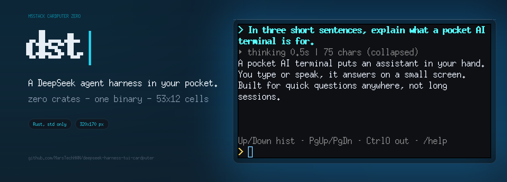
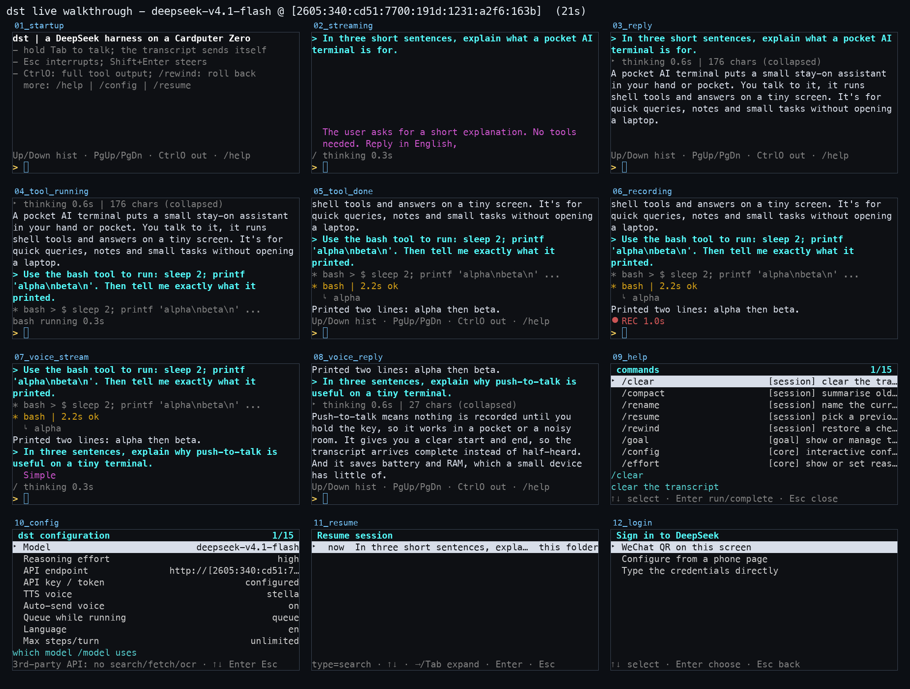
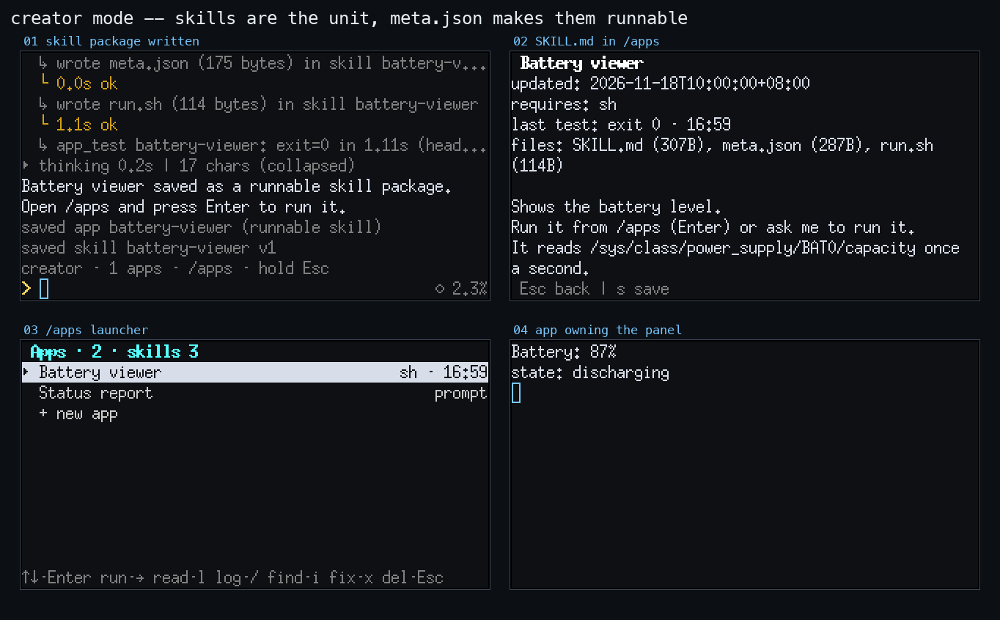
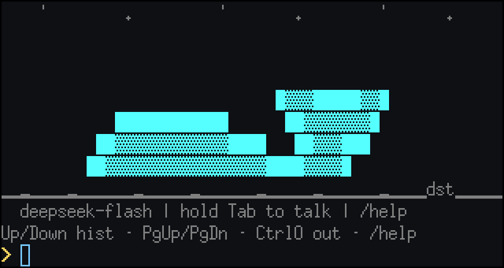
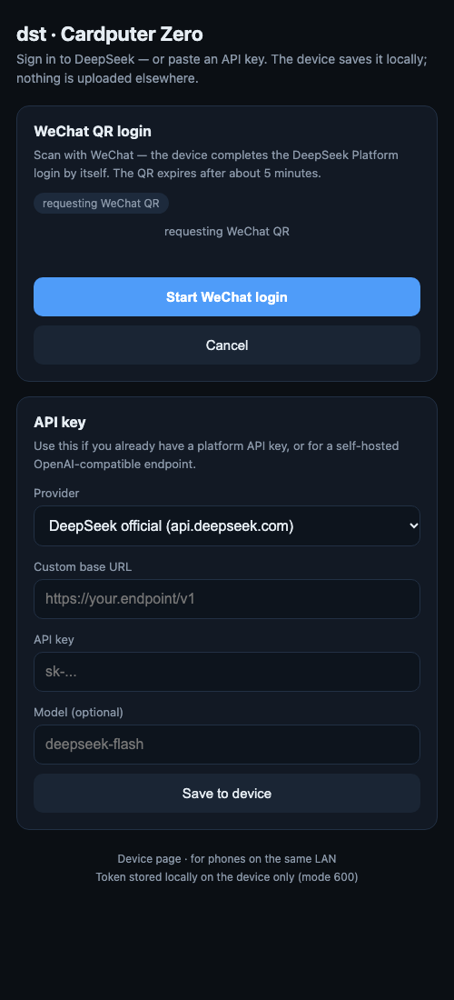
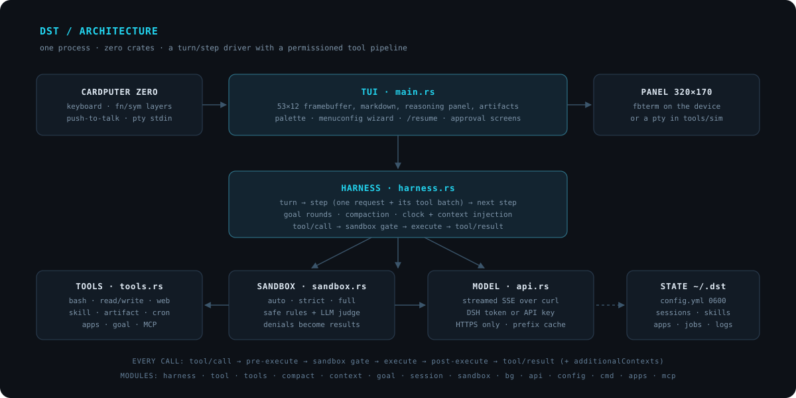

<div align="center">



# dst

**The whole DeepSeek Harness agent loop — turns, tools, goals, compaction — in one
zero-dependency Rust binary, on a 320×170 handheld.**

*a DeepSeek harness TUI for the M5Stack Cardputer Zero*

<a href="LICENSE"></a>


<a href="CONTRIBUTING.md"></a>

<a href="#quick-start">Quick start</a> ·
<a href="#screenshots">Screenshots</a> ·
<a href="#features">Features</a> ·
<a href="#commands">Commands</a> ·
<a href="#architecture">Architecture</a> ·
<a href="#testing-without-the-device">Simulator</a> ·
<a href="#documentation">Documentation</a>

</div>

---

`dst` is a pocket-sized agent: a terminal UI and an agent harness that run
entirely on a **M5Stack Cardputer Zero** — a Raspberry Pi CM0 handheld with
512 MB of RAM and a 320×170 panel that holds **53 columns × 12 rows** of text.

It is not a chat client with a keyboard bolted on. The loop is the real thing,
ported from the DeepSeek Harness (DSH): a turn owns steps, a step is one model
request plus its tool batch, and every call travels
`tool/call → pre-execute → sandbox gate → execute → post-execute → tool/result`
with `additionalContexts` injected after the batch. Tools return canonical JSON;
a separate `render()` projects it to the text the model reads.

<table>
<tr>
<td width="50%" valign="top">

**Why it exists**

Everything else assumes a desktop: a browser, a big terminal, a fast CPU, a
battery you can drain. `dst` assumes the opposite — 12 rows, a thumb keyboard,
and a 512 MB device that still deserves a real agent loop with permissions,
memory and goals.

</td>
<td width="50%" valign="top">

**What it is not**

No subagents, no remote server, no cloud sandbox, no telemetry. One process,
one binary, `~/.dst` for state, an OpenAI-compatible (or DeepSeek) endpoint for
intelligence, and `curl` for the wire.

</td>
</tr>
</table>

---

## Table of Contents

- [Screenshots](#screenshots)
- [Features](#features)
  - [Agent loop](#agent-loop)
  - [Tools](#tools)
  - [Permissions and sandbox](#permissions-and-sandbox)
  - [Goals, context and memory](#goals-context-and-memory)
  - [Interface](#interface)
  - [Creator mode](#creator-mode)
  - [Voice](#voice)
  - [Internationalisation](#internationalisation)
- [Quick start](#quick-start)
- [Commands](#commands)
- [Key bindings](#key-bindings)
- [Configuration](#configuration)
- [Architecture](#architecture)
- [Testing without the device](#testing-without-the-device)
- [Deploying to the device](#deploying-to-the-device)
- [Documentation](#documentation)
- [Contributing](#contributing)
- [License](#license)

---

## Screenshots

<table>
<tr>
<td width="50%"><br><sub><b>Live walkthrough</b> — 12 real screens against a local model: streaming, reasoning, a tool card, push-to-talk, <code>/help</code>, <code>/config</code>, <code>/resume</code>, <code>/login</code>.</sub></td>
<td width="50%"><br><sub><b>Creator mode</b> — the model writes an app (<code>battery</code>), saves the package, and <code>/apps</code> runs it full-screen.</sub></td>
</tr>
<tr>
<td width="50%"><br><sub><b>Splash</b> — a 14-frame whale breach drawn on the device pixel grid, deterministic so snapshots are reproducible.</sub></td>
<td width="50%"><br><sub><b>Sign-in</b> — scan a WeChat QR on the panel, use the LAN page from a phone, or type the credential on the device.</sub></td>
</tr>
</table>

<div align="center">
<sub><a href="docs/splash-frames.png">Frame sheet</a> · <a href="docs/login-qr-screen.png">QR on the panel</a> · <a href="docs/login-i18n-sheet.png">login in six languages</a></sub>
</div>

---

## Features

### Agent loop

- **DSH turn/step driver.** A turn owns steps; a step is one model request plus
  its tool batch. Tool calls are rendered when they *start* and settle into a
  one-row card with duration and a preview, in `tool/call` → `tool/result` order.
- **Streaming with a live reasoning panel.** Reasoning deltas stream above the
  prompt and fold to one dim line when the answer begins.
- **No step cap by default.** A turn may use as many steps as it needs
  (`agent.max_steps` opts into a cap, `0` = unlimited). Every tool declares a
  deadline; an overrun settles as `tool timed out after Ns` without freezing the
  prompt, and `Esc` still works while a tool runs.
- **Prefix-cache friendly requests.** The system prompt and shadowed history are
  replayed verbatim so DeepSeek's cache keeps hitting across turns.

### Tools

The model sees 32 tools in normal mode (list yours with `dst --tools`);
creator mode adds the app and skill tools at the bottom of the table:

| group | tools |
| --- | --- |
| shell & files | `bash`, `read_file`, `write_file`, `edit_file`, `list_dir`, `glob`, `grep` |
| web + vision | `search`, `fetch`, `ocr` |
| orchestration | `artifact`, `speak`, `rename`, `todo_read`, `todo_write`, `skill` |
| background | `job_start`, `job_output`, `job_wait`, `job_kill`, `job_list`, `watcher_start`, `watcher_list`, `watcher_stop` |
| goals | `get_goal`, `create_goal`, `update_goal` |
| memory | `memory_write`, `memory_read`, `memory_search` |
| scheduling | `cron`, `watch` |
| creator mode | `app_save`, `app_file`, `app_run`, `app_test`, `app_export`, `app_import`, `skill_save`, `skill_file`, `skill_rollback` |

Any MCP server in `~/.dst/mcp.json` adds its tools as `mcp__<server>__<tool>`.

### Permissions and sandbox

Every tool call passes a gate with three modes (`sandbox.mode`; switched in
`/config`, chosen once during onboarding):

- **`auto`** (default) — known-safe reads and workspace writes pass; system
  changes (`sudo`, `systemctl start/stop`, package managers, mounts, writes
  under `/etc`, `/boot`, `/usr`, reboot) are refused outright; anything else
  gets one short LLM call to judge it.
- **`strict`** — a full-screen allow/reject dialog for every non-safe call.
- **`full`** — everything runs.

A refusal becomes a failed tool result with the concrete reason, so the model
can explain instead of retrying. HTTPS is enforced: non-TLS endpoints are
refused.

### Goals, context and memory

- **Goals** (`/goal`) are persisted objectives that keep the session working
  across automatic continuation rounds. The model judges itself through
  `update_goal`: `complete` only when achieved, `blocked` only after one concrete
  condition persisted for three rounds. Round and step caps are configurable;
  `Esc` disarms, `/goal resume` re-arms.
- **Automatic compaction** at `agent/pre-step`: prune oversized old tool results,
  keep a verbatim tail on a user-message boundary, then one streamed summary
  call framed as an `<compacted-summary>` checkpoint. A provider overflow forces
  one compaction and retries once. `/compact` runs it on demand.
- **Context injection** — an attributed clock reading
  (`Time sampled while preparing turn N, step M: …`), a repeat-tool reminder
  after the third and fifth identical call, and `additionalContexts` from tools.
- **Memory** — `AGENTS.md` from the workspace and `~/.dst` is loaded into the
  prompt (bounded), and `memory_write`/`memory_read`/`memory_search` keep short
  preferences across sessions.
- **`/usage`** reports cache hit rate, cache read, uncached input and output
  with share bars; a ring (`○ ◔ ◑ ◕ ●`) on the status line shows context pressure.

### Interface

- Markdown-aware rendering (headings, lists, dimmed code blocks), word-aware
  wrapping at the real 53-cell width, UTF-8 and CJK input.
- **Command palette** — type `/` for every command with its description and
  argument hint; menus are menuconfig-style with right-aligned values.
- **Full-screen artifacts** — the model can take over the panel with tables,
  code or checklists; `Esc` dismisses, `PgUp`/`PgDn` scroll.
- **Sessions** — every turn is saved with a title the model keeps current via
  the `rename` tool; `/resume` previews sessions grouped by directory, `/rewind`
  restores a checkpoint.
- **Background tasks** — jobs and watchers with a manager (Down on an empty
  prompt), live progress on the status line, and coalesced watcher messages.
- **Tool output viewer** (`CtrlO`) — recent tool results in a scrollable panel,
  `s` saves the text under `~/.dst/tmp/`.
- **Queueing** — typing during a turn queues by default; `Shift+Enter`
  interrupts and sends; `CtrlQ` edits the queue.
- **Animated splash** — a deterministic whale breach, frame-scheduled rather
  than constant-rate; typing pauses it, the first message ends it, `/clear`
  brings it back.

### Creator mode

An opt-in mode where `dst` is the device's only program: everything you use is
something it built and saved.

- Each build becomes a package under `~/.dst/apps/<category>/<name>/` —
  `app.json` manifest, `APP.md` annotation, entry program, `state/` dir.
  Kinds: `sh`, `python`, `binary`, `prompt`, `doc`.
- The model writes apps with `app_save`/`app_file`, verifies them headlessly with
  `app_test` (piped stdio or a real pty), runs them with `app_run` (full-screen
  takeover, args, timeout) and packs them with `app_export`/`app_import`.
- Launches are bounded: long-press `Esc` always leaves an app, a timeout
  backstop, ulimits, a scrubbed environment, and cwd/state inside the package.
- Run and test history lands back in `app.json`, is shown in `/apps` (a `!`
  marks a failing app) and is surfaced to the model so it fixes what it broke.
- **Skills** are the other half: `skill_save`/`skill_file` write a versioned
  `SKILL.md` package with `.history/vN.md` and `skill_rollback`.

> Full design: [`docs/CREATOR.md`](docs/CREATOR.md).

### Voice

Push-to-talk (`Tab`) records with `arecord`, posts to `/v1/tools/asr` and
auto-sends the transcript; TTS (`/v1/tools/tts`) plays through `aplay`.
Resampling and WAV framing are done in Rust. Speech tools exist only on
DeepSeek's official API — on a third-party endpoint they are removed from the
registry and the model is told so.

### Internationalisation

`language: en | zh | es | ja | de | it` in the config (switchable in `/config`).
Every user-visible string is translated — menus, palette previews, approval
dialogs, onboarding, login pages, job and watcher states. A unit test fails the
build if any language misses a key. Tool descriptions and the system prompt stay
English so model behaviour does not change with the UI language.

---

## Quick start

### 1. Requirements

| need | why |
| --- | --- |
| Linux (Debian 13 on the device) | `fbterm`, `alsa-utils` for the panel and audio |
| Rust 2021 (dev machine for the simulator) | building `dst` |
| `curl` | every HTTP request (model, web tools, login) |
| `arecord`/`aplay` (`alsa-utils`) | optional: ASR capture, TTS playback |
| `qrencode`, `python3` + Pillow | optional: phone-page QR, WeChat QR on the panel |

### 2. Build

Zero crates, so the build needs no network at all:

```sh
git clone git@github.com:MarsTechHAN/deepseek-harness-tui-cardputer.git
cd deepseek-harness-tui-cardputer

# On the device the 512 MB of RAM cannot survive parallel LTO:
CARGO_BUILD_JOBS=1 cargo build --release
install -m755 target/release/dst /usr/local/bin/dst
```

Release profile: `opt-level="z"`, LTO, `panic=abort`, `strip` → a ~1 MB binary.

### 3. First run

```sh
dst
```

The first launch asks for an endpoint (DeepSeek official or any
OpenAI-compatible one) and a sandbox mode. To sign in to the DeepSeek Platform
properly, use `/login`:

1. **WeChat QR on the panel** — the same nine-step flow as the DSH desktop
   client, with live status and a QR countdown;
2. **Phone page** — `http://<device-ip>:8787/` shows the QR, live steps and a
   manual API-key form, in the device's UI language;
3. **Type it** — a DSH token, or base URL + API key + model.

Credentials live in `~/.dst/config.yml` (mode `600`). A DSH token is sent as
`x-dsh-auth-token`; an API key as `Authorization: Bearer`.

### 4. Talk to it

```sh
dst                      # interactive TUI
dst --once "summarise this repo"        # one turn, prints events
dst --tools                             # effective tool set + capability decision
dst --call bash '{"command":"uname -a"}'  # run one tool exactly as the model would
dst --voice-selftest 3                  # record, report RMS and transcript
```

---

## Commands

Commands run locally and are never sent to the model.

| command | what it does |
| --- | --- |
| `/help` | list commands, grouped by category, with a live preview |
| `/model [name]` | show models from `/v1/models` or switch to one |
| `/effort [auto, low, high, max]` | reasoning effort |
| `/config [wizard]` | interactive configuration (options first) |
| `/login` | DeepSeek sign-in: WeChat QR, phone page, or typed credential |
| `/key <api-key>` | set the API key directly |
| `/usage` | cache hit rate, tokens in/out, context pressure |
| `/compact` | summarise older history now |
| `/goal [show, <objective>, edit, pause, resume, clear]` | long-running objective |
| `/apps [run <name>]` | browse, run or delete apps the model built |
| `/extensions` | inspect skills and MCP servers |
| `/resume` | pick a previous session (preview on `→`) |
| `/rewind` | restore a checkpoint from an earlier turn |
| `/rename <title>` | name the current session |
| `/clear` | clear the transcript and restart the splash |
| `/quit` | exit |

## Key bindings

| key | action |
| --- | --- |
| `Enter` | send |
| `Shift+Enter` | interrupt the running turn and send immediately |
| `Esc` | abort the turn (and any playing speech); long-press leaves an app |
| `Tab` | push-to-talk while held |
| `/` | command palette |
| `Up`/`Down` | input history; on an empty prompt with jobs: the task manager |
| `PgUp`/`PgDn`, `Home`/`End` | scroll the transcript / jump to top or bottom |
| `CtrlO` | recent tool output (Enter opens, `s` saves) |
| `CtrlQ` | edit the queued message |
| `CtrlA`/`CtrlE`, `CtrlW` | cursor to start/end, delete a word |

---

## Configuration

`~/.dst/config.yml` — DSH's YAML patch dialect: plain settings plus `insert:`
rows shaped `{ id, name, config, disabled }` that target a tool by `name`.

```yaml
model: deepseek-flash
effort: high                 # auto | low | high | max
max_tokens: 4096
api:
  base: https://api.deepseek.com/v1
  key: sk-...                # kept in this file, mode 600
tui:
  language: en               # en | zh | es | ja | de | it
  mode: normal               # normal | creator
agent:
  max_steps: 0               # 0 = unlimited
goal:
  max_rounds: 256
  max_steps: 0
compaction:
  enabled: true
  threshold_tokens: 512000
sandbox:
  mode: auto                 # auto | strict | full

insert:
  - id: speak
    name: speak
    disabled: true
```

Every key, including the numeric budgets and the `insert:` rows, is documented
in [`docs/CONFIGURATION.md`](docs/CONFIGURATION.md). `/config` edits the same
values interactively; `/config path` prints the file location.

---

## Architecture



| file | role |
| --- | --- |
| `src/main.rs` | TUI: framebuffer terminal, input, panels, wizard, resume |
| `src/harness.rs` | turn/step driver (DSH agent-loop port) |
| `src/tool.rs` | tool contracts and the execution pipeline |
| `src/tools.rs` | built-in tool registry |
| `src/sandbox.rs` | permission gate: safe rules, danger rules, LLM judge |
| `src/api.rs` | streaming chat client over a `curl` subprocess |
| `src/compact.rs` | automatic and manual context compaction |
| `src/context.rs` | in-progress context injection (clock, repeat reminder) |
| `src/goal.rs` | goal state machine, tools and the round driver |
| `src/session.rs` | session titles, `rename` tool, `/resume` previews |
| `src/checkpoint.rs` | turn checkpoints for `/rewind` |
| `src/bg.rs` | background jobs and line watchers |
| `src/jobs.rs` | cron and file-watch scheduler |
| `src/skills.rs` | skill catalog and progressive loader |
| `src/apps.rs` | creator mode: app packages, catalog, screen takeover |
| `src/mcp.rs` | MCP stdio client |
| `src/voice.rs` | TTS/ASR, resampling, WAV framing, recorder |
| `src/config.rs` | `~/.dst` home and the DSH-dialect YAML config |
| `src/cmd.rs` | human commands |
| `src/i18n.rs` | six-language UI catalog |
| `src/login.rs`, `src/dsh_login.rs` | login page + QR, nine-step DSH/WeChat login |
| `src/art.rs` | the animated splash |
| `src/json.rs` | minimal JSON |

Deeper notes on the loop, compaction, goals and the permission model:
[`docs/ARCHITECTURE.md`](docs/ARCHITECTURE.md).

---

## Testing without the device

The TUI is a plain ANSI program, so it runs under a pty anywhere.
[`tools/sim`](tools/sim/README.md) contains a screen simulator (53×12 pty → pyte
→ PNG at the device's native 320×170 with the X11 6×13 bitmap font) and a
scripted OpenAI-compatible mock server. No hardware, no network, no API key.

```sh
cargo build                       # host binary

cd tools/sim
python3 run_demo.py               # splash → thinking → tool call → reply + contact sheet
python3 run_scenarios.py          # feature scenarios, asserts on screens *and* request logs
python3 run_live.py               # visual walkthrough against a real local endpoint
python3 check_memory.py           # samples RSS over 20 turns
```

`run_scenarios.py` covers the feature matrix end to end: thinking panel, tool
call ordering, timeouts, `Esc`, step limits, repeat/time context injection,
automatic and manual compaction, every `/goal` flow, `/config`, the palette,
artifacts, sessions across a restart, onboarding, sandbox modes, jobs, watchers,
searchable resume, push-to-talk with mocked speech, the nine-step WeChat login
chain, provider failures and recovery, CJK input and the creator-mode scenarios.

Unit tests (host, no network): `cargo test` — 73 tests over the harness, tool
pipeline, compaction budgets, goal state machine, context formatting, config
round-trip, skills, apps and the i18n catalogue.

---

## Deploying to the device

The device boots `cpzterm.service` (`fbterm` + `dst`). The deploy script copies
sources, builds on the device (single-threaded LTO), installs the binary and
restarts the service:

```sh
tools/deploy/deploy.sh hanxiao@192.168.43.49
```

`DST_SSH_KEY` selects a key; `DST_SSH_PASSWORD` (needs `sshpass`) uses password
auth. `tools/deploy/fix-cpzterm-order.sh` repairs an early-boot ordering cycle
(`Before=sysinit.target` deadlocks boot with `Resource deadlock avoided`).

---

## Documentation

| document | contents |
| --- | --- |
| [`docs/ARCHITECTURE.md`](docs/ARCHITECTURE.md) | turn/step loop, tool pipeline, compaction, goals, permissions |
| [`docs/CONFIGURATION.md`](docs/CONFIGURATION.md) | every config key, `insert:` rows, capabilities per endpoint |
| [`docs/CREATOR.md`](docs/CREATOR.md) | creator mode: requirements, package layout, prompt and takeover contract |
| [`docs/LOGIN.md`](docs/LOGIN.md) | DeepSeek sign-in: states, requirements, troubleshooting — [中文](docs/LOGIN.zh.md) · [ES](docs/LOGIN.es.md) · [日本語](docs/LOGIN.ja.md) · [DE](docs/LOGIN.de.md) · [IT](docs/LOGIN.it.md) |
| [`docs/UX-AUDIT.md`](docs/UX-AUDIT.md) | screen-by-screen UX audit checklist and known limits |
| [`docs/UX-LIVE.md`](docs/UX-LIVE.md) | the common-usage walkthrough behind the screenshots |
| [`docs/SPLASH-STORYBOARD.md`](docs/SPLASH-STORYBOARD.md) | splash frame storyboard and reference analysis |
| [`tools/sim/README.md`](tools/sim/README.md) | simulator, mock API, scenario DSL, screenshot pipeline |

## Contributing

Issues and pull requests are welcome — see [`CONTRIBUTING.md`](CONTRIBUTING.md)
for the build, test and screenshot workflow. Security reports: see
[`SECURITY.md`](SECURITY.md).

`dst` keeps a few promises that make review easy: **no third-party crates**, no
credentials in the tree, and every UI string in the i18n catalogue.

## License

[GPL-3.0](LICENSE) © MarsTechHAN

## Acknowledgements

- The DeepSeek Harness (DSH) for the agent-loop, compaction, goal and
  instructions architecture this port follows.
- The public-domain X11 6×13 bitmap font, vendored for pixel-accurate
  screenshots.
- The original dsh-TUI pixel whale, reused frame-for-frame in the splash.

<div align="center">
<br>
<a href="https://star-history.com/#MarsTechHAN/deepseek-harness-tui-cardputer&Date">
  
</a>
<br><br>
<sub>Built for a 320×170 screen — and for the idea that a pocket device deserves a real agent loop.</sub>
</div>
