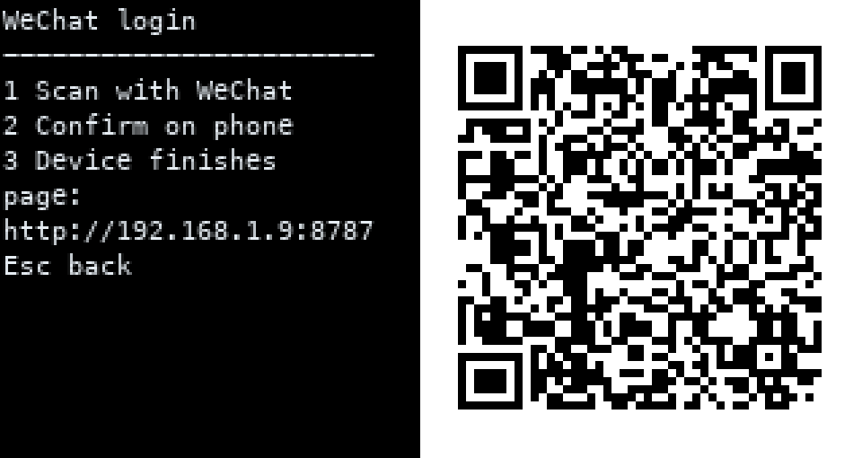

# Iniciar sesión en dst

dst admite dos tipos de credenciales, guardadas en `~/.dst/config.yml` (modo 600):

| Credencial | Cómo se obtiene | Cabecera enviada a la API |
| --- | --- | --- |
| **Token DSH** (recomendado en uso personal) | login real con QR de WeChat en DeepSeek Platform (`/login`) | `x-dsh-auth-token: <token>` |
| **API key** | key que ya tengas, o endpoint propio | `Authorization: Bearer <key>` |

`/config` muestra la fila `API key / token` y el valor `DSH token` cuando hay uno.
Al guardar una API key (`/key`, el formulario del config o el onboarding) se
sustituye el token para que la nueva key no quede eclipsada.

## Tres formas de iniciar sesión

Ejecuta `/login` (o elige *DeepSeek official* en el onboarding):

1. **QR de WeChat en el dispositivo** — dst solicita el QR de WeChat para
   DeepSeek Platform y lo pinta a la derecha del panel; a la izquierda hay una
   guía numerada y una cuenta atrás `QR valid for m:ss`. Escanea con WeChat,
   confirma en el teléfono y el dispositivo termina solo el intercambio de token.
2. **Página en el teléfono** — `http://<ip-del-dispositivo>:8787/`. Muestra el
   mismo QR, progreso en vivo, cuenta atrás, Cancel/Retry, un formulario para
   pegar una API key y otro para pegar un token DSH existente. Sigue el idioma
   de la UI del dispositivo (en/zh/es/ja/de/it).
3. **Escribir directamente** — menú estilo menuconfig para pegar un token DSH o
   introducir Base URL + API key + modelo.

Los nueve pasos son los mismos que en el cliente de escritorio DSH:
`wechat qrconnect → QR jpeg → long-poll → nonce de callback → token de sesión
web → auth_init (PKCE) → auth_approve → auth_exchange → token DSH`.

## Requisitos

- Acceso a `open.weixin.qq.com`, `lp.open.weixin.qq.com`,
  `platform.deepseek.com`, `api.deepseek.com`.
- Reloj del sistema correcto (validación TLS).
- `python3` + Pillow **solo** para pintar el QR en el panel; sin ellos dst
  recurre a la página del teléfono, que muestra el mismo QR.
- Puerto 8787 libre (si no, dst usa un puerto efímero).

## Estados durante el login

| Estado | Dispositivo | Página del teléfono |
| --- | --- | --- |
| esperando | `→ QR valid for 4:50` | cuenta atrás localizada |
| escaneado | `→ scanned — confirm on the phone` | estado localizado |
| confirmando | `→ authorized — finishing login…` | estado localizado |
| caducado | 1.ª vez refresca solo; a la 2.ª: `login failed — press r to retry` (`r retry · t type · Esc cancel`) | *QR expired — refreshing…*, reintenta una vez; queda Retry |
| cancelado | Esc en el dispositivo | Cancel en la página |

## Problemas frecuentes

| Síntoma | Causa / solución |
| --- | --- |
| El QR no se escanea | El QR lo genera WeChat y se pinta píxel a píxel; comprueba `python3`+Pillow y que la pantalla no esté tapada. La página muestra el mismo QR. |
| `QR expired` dos veces | Wi-Fi o reloj inestables. Revisa la hora y la red; pulsa `r` (nuevo QR), `t` (escribir token/API key) o Retry en la página. |
| `login failed` con códigos HTTP/biz | La página muestra un resumen localizado y el detalle técnico; reintenta más tarde o usa una API key. |
| `invalid dsh token` / `auth failed: use /key or /login` | Token caducado: repite `/login` o cambia a API key con `/key`. |
| La página no abre | Teléfono y dispositivo deben estar en la misma LAN y el puerto 8787 accesible (usa la URL del panel). |
| Cuadros en chino/japonés en el panel | Falta una fuente CJK en el dispositivo (ver `docs/UX-AUDIT.md`); la página sigue funcionando. |

Seguridad: un token DSH equivale a una sesión de cuenta. Solo se guarda en el
dispositivo (modo 600) y dst nunca lo sube. En dispositivos compartidos usa una
API key oficial; este flujo es privado del cliente DSH y la plataforma puede
cambiarlo.
