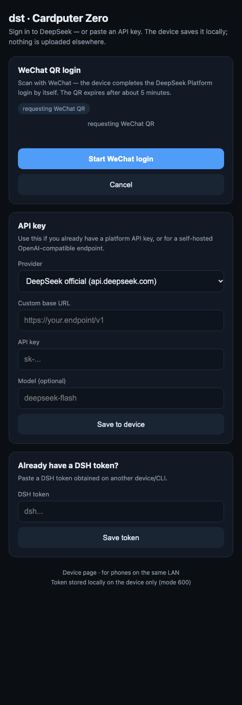

# Logging in to dst

dst accepts two credential types, both stored in `~/.dst/config.yml` (mode 600):

| Credential | How it is obtained | Sent to the API as |
| --- | --- | --- |
| **DSH token** (recommended for personal use) | real DeepSeek Platform WeChat login (`/login`) | `x-dsh-auth-token: <token>` |
| **API key** | platform key you already have, or a self-hosted endpoint | `Authorization: Bearer <key>` |

`/config` shows `API key / token` as the row and `DSH token` as its value when a
token is stored. Setting an API key (`/key`, the config prompt, or onboarding)
replaces the token, so the new key is not shadowed.

## Three ways to sign in

Run `/login` (or pick *DeepSeek official* during onboarding):

1. **WeChat QR on the device** — dst requests a WeChat QR for the DeepSeek
   Platform and paints it on the right of the panel; a numbered guide and a
   `QR valid for m:ss` countdown sit on the left. Scan with WeChat, confirm on
   the phone, and the device finishes the nine-step token exchange by itself.
2. **Phone page** — dst serves `http://<device-ip>:8787/` on the LAN. The page
   shows the same QR, live progress, a QR countdown, Cancel and Retry buttons,
   a manual API-key form, and a field to paste an existing DSH token. The page follows the device UI language
   (en/zh/es/ja/de/it).
3. **Type directly** — menuconfig-style entry for a DSH token, or Base URL +
   API key + model.

The nine steps (same as the DSH desktop client):
`wechat qrconnect → QR jpeg → scan long-poll → callback nonce → web session
token → auth_init (PKCE) → auth_approve → auth_exchange → DSH token`.

## Requirements

- Network access to `open.weixin.qq.com`, `lp.open.weixin.qq.com`,
  `platform.deepseek.com`, `api.deepseek.com`.
- Correct system clock (TLS certificate validation).
- `python3` + Pillow **only** for painting the WeChat JPEG on the panel. Without
  them dst falls back to the phone page, which still shows the same QR.
- Port 8787 free (dst falls back to an ephemeral port if it is busy).

## What you see while signing in

| State | Device | Phone page |
| --- | --- | --- |
| waiting | `→ QR valid for 4:50` | `expires in 4:50` |
| scanned | `→ scanned — confirm on the phone` | localized status |
| confirming | `→ authorized — finishing login…` | localized status |
| expired | first expiry refreshes automatically; a second shows `login failed — press r to retry` (`r retry · t type · Esc cancel`) | shows *QR expired — refreshing…* and retries once; Retry button remains |
| cancelled | Esc (device) / Cancel (page) aborts immediately | localized *login cancelled* |

## Troubleshooting

| Symptom | Meaning / fix |
| --- | --- |
| QR not scannable | The QR image is generated by WeChat and painted pixel-exact; check that `python3`+Pillow is installed and that the panel is not covered. The phone page shows the identical QR. |
| `QR expired` twice | Clock/network flakiness. Check Wi-Fi and system time, then press `r` (new QR), `t` (type a token/API key instead), or Retry on the page. |
| `login failed` with HTTP/biz codes | The page shows a localized summary plus the technical detail; the platform may have changed or rejected the request. Wait and retry, or use an API key for now. |
| `50005 PAYLOAD_SCHEMA_MISMATCH` | The redirect URI must be `http://127.0.0.1:<port>/oauth/callback`; normally handled by dst. |
| `invalid dsh token` / `auth failed: use /key or /login` | The stored token is stale. Re-run `/login`, or switch to an API key with `/key`. |
| Phone page unreachable | Phone and device must be on the same LAN and port 8787 reachable (check the URL shown on the panel). |
| Panel shows boxes for Chinese/Japanese | Missing CJK font on the device (`docs/UX-AUDIT.md` covers fonts); the page still works. |

Security: a DSH token is equivalent to an account session. It is stored only on
the device (mode 600) and is never uploaded by dst. Prefer an official API key
for shared devices; this login path is the DSH client's private flow and the
platform may change it.
