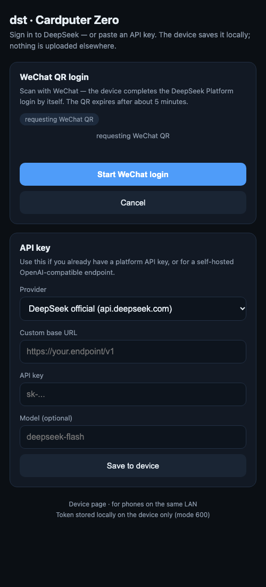

# dst 登录指南

dst 支持两种凭据，都保存在 `~/.dst/config.yml`（权限 600）：

| 凭据 | 获取方式 | 请求头 |
| --- | --- | --- |
| **DSH token**（个人使用推荐） | `/login` 走真实 DeepSeek 平台微信扫码登录 | `x-dsh-auth-token: <token>` |
| **API key** | 已有平台 key，或自建 endpoint | `Authorization: Bearer <key>` |

`/config` 的凭据行显示 `API key / token`，存有 token 时值为 `DSH token`。
设置 API key（`/key`、配置输入、onboarding）会清掉旧 token，确保新 key 生效。

## 三种登录方式

执行 `/login`（或在首次引导中选择 DeepSeek 官方）：

1. **设备显示微信二维码**：dst 申请 DeepSeek 平台的微信二维码，画在面板右侧；
   左侧是编号步骤、`QR valid for m:ss` 倒计时和取消提示。手机微信扫码并在手机上确认后，
   设备会自动完成九步 token 交换。
2. **手机网页**：访问 `http://<设备IP>:8787/`。页面显示同一二维码、扫码进度、
   二维码倒计时、Cancel / Retry 按钮，以及粘贴 API key 的表单；页面跟随设备
   UI 语言（en/zh/es/ja/de/it）。
3. **直接输入**：menuconfig 风格，直接粘贴 DSH token，或输入 Base URL + API key + 模型。

九步链路与 DSH 客户端一致：
`wechat qrconnect → 二维码 JPEG → 扫码长轮询 → 回调 nonce → 网页会话 token →
auth_init(PKCE) → auth_approve → auth_exchange → DSH token`。

## 依赖条件

- 能访问 `open.weixin.qq.com`、`lp.open.weixin.qq.com`、
  `platform.deepseek.com`、`api.deepseek.com`。
- 设备系统时间准确（TLS 证书校验需要）。
- **仅设备本机画二维码**需要 `python3` + Pillow；没有时会自动退回手机网页模式，
  网页上的二维码完全一样。
- 8787 端口可用（被占用时 dst 会自动换一个临时端口）。

## 扫码过程状态

| 状态 | 设备屏 | 手机网页 |
| --- | --- | --- |
| 等待扫码 | `→ QR valid for 4:50` | `expires in 4:50` |
| 已扫码 | `→ scanned — confirm on the phone` | 本地化状态 |
| 确认中 | `→ authorized — finishing login…` | 本地化状态 |
| 过期 | 第一次自动刷新；再次失败显示 `login failed — press r to retry`（`r retry · t type · Esc cancel`） | 显示“二维码过期 — 正在刷新…”并自动重试一次；Retry 按钮保留 |
| 取消 | 设备按 Esc 立即中断 | 网页点 Cancel 立即中断 |

## 常见问题

| 现象 | 原因 / 处理 |
| --- | --- |
| 二维码扫不出来 | 二维码来自微信且按像素绘制；确认设备有 `python3`+Pillow、屏幕未被遮挡；网页端有同一二维码。 |
| 连续两次 `QR expired` | 网络或时钟不稳定；检查 Wi-Fi 与系统时间后按 `r`（重新扫码）、`t`（改为直接输入 token/API key），或网页 Retry。 |
| `login failed` 带 HTTP/biz code | 网页会显示本地化摘要 + 技术细节；多为平台接口变化或请求被拒。稍后重试，或暂时改用 API key。 |
| `50005 PAYLOAD_SCHEMA_MISMATCH` | redirect URI 必须为 `http://127.0.0.1:<端口>/oauth/callback`，正常由 dst 处理。 |
| `invalid dsh token` / `auth failed: use /key or /login` | token 已失效；重新 `/login`，或用 `/key` 切换 API key。 |
| 手机打不开网页 | 手机与设备需在同一局域网，且 8787 端口可达（以设备屏幕显示的 URL 为准）。 |
| 面板中文/日文显示方块 | 设备缺 CJK 字体（见 `docs/UX-AUDIT.md`），网页端不受影响。 |

安全提示：DSH token 等价于账号会话，只保存在设备本地（mode 600），dst 不会上传。
共享设备建议使用官方 API key；该登录链路是 DSH 客户端私有流程，平台可能调整。
